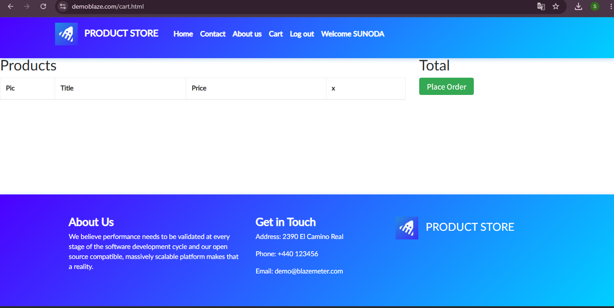
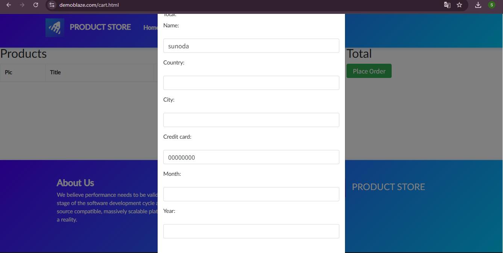
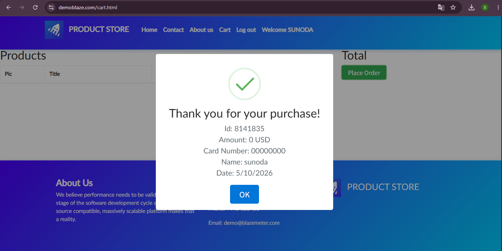
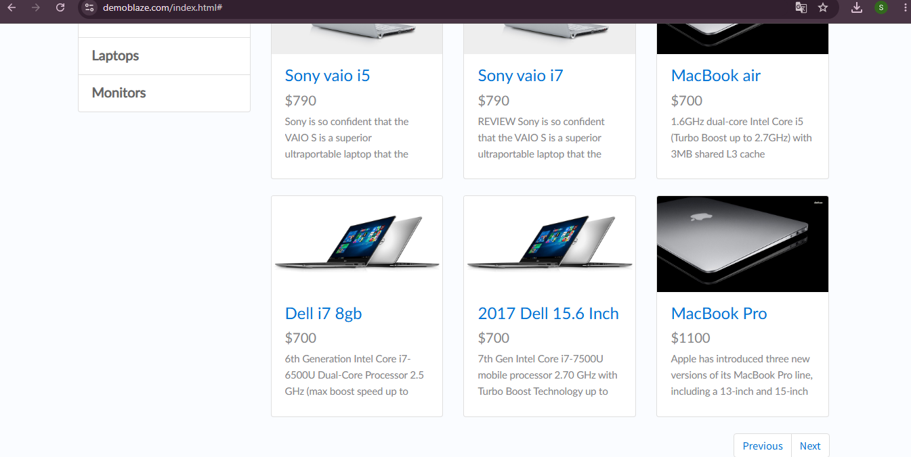
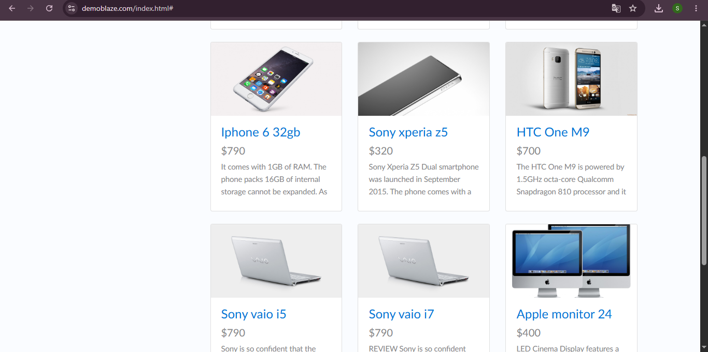
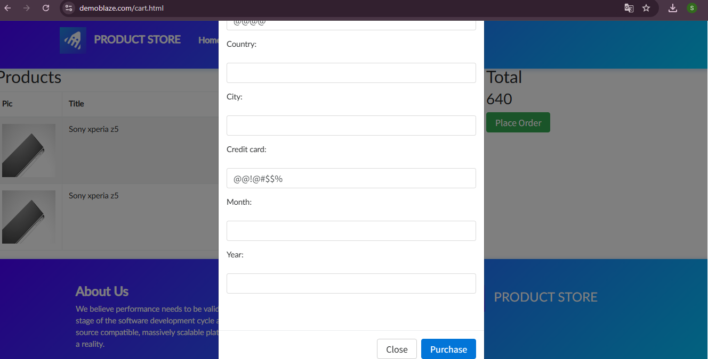
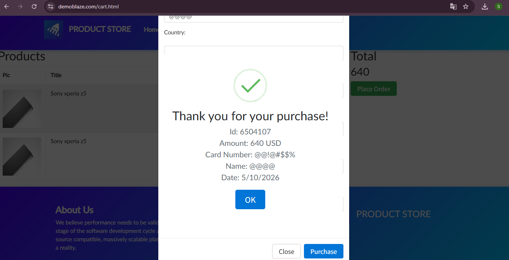

# Bugs e melhorias - Demoblaze

**Ambiente:** Chrome 156.0.8078.76 · Windows 10 22H2 (Build 19045.6466) · 1920x1080

Resumo dos bugs encontrados na execução do [plano de testes](01-Plano-de-Testes.md):

| ID | Título | Severidade | Prioridade | Caso |
|---|---|---|---|---|
| BUG-003 | CHECKOUT – Compra é concluída com o carrinho vazio | Critical | Alta | CT-025 |
| BUG-001 | PAGINAÇÃO – Botão Previous ignora a categoria e lista produtos de todas as categorias | Major | Média | CT-003, CT-004 |
| BUG-004 | CHECKOUT – Campos nome e cartão aceitam letras e caracteres especiais sem validação | Major | Média | CT-021 |
| BUG-002 | MONITORS – Botão Next aparece em categoria com apenas 2 produtos | Minor | Baixa | CT-004 |
| BUG-005 | CONTACT – Mensagem é enviada com todos os campos vazios | Minor | Baixa | CT-026 |

## BUG-003 - CHECKOUT – Compra é concluída com o carrinho vazio

- **Severidade / Prioridade:** Critical / Alta
- **Caso de teste:** CT-025
- **Descrição:** O Demoblaze conclui um pedido mesmo sem nenhum produto no carrinho, gerando uma compra sem itens. O fluxo principal do e-commerce aceita uma regra de negócio inválida.
- **Pré-condição:** Carrinho vazio.

**Passos para reproduzir:**

1. Acessar https://www.demoblaze.com
2. Abrir 'Cart'
3. Clicar em 'Place Order'
4. Preencher apenas Name e Credit card
5. Clicar em 'Purchase'

**Resultado esperado:** O sistema impede o pedido e informa que o carrinho está vazio.

**Resultado obtido:** A compra é concluída e a tela de confirmação é exibida.

**Evidências:**

## BUG-001 - PAGINAÇÃO – Botão Previous ignora a categoria e lista produtos de todas as categorias

- **Severidade / Prioridade:** Major / Média
- **Caso de teste:** CT-003, CT-004
- **Descrição:** Depois de avançar a página dentro de uma categoria, o botão Previous não mantém o filtro e mostra produtos de várias categorias. Ocorre em Laptops e em Monitors.
- **Pré-condição:** Estar na Home.

**Passos para reproduzir:**

1. Acessar a Home
2. Clicar em 'Laptops'
3. Clicar em 'Next'
4. Clicar em 'Previous'

**Resultado esperado:** Volta para a página anterior de Laptops, somente com notebooks.

**Resultado obtido:** A lista mostra produtos de várias categorias. O mesmo ocorre em Monitors.

**Alternativa:** clicar de novo na categoria no menu lateral. Por isso a severidade é Major e não Critical.

**Evidências:**

## BUG-004 - CHECKOUT – Campos nome e cartão aceitam letras e caracteres especiais sem validação

- **Severidade / Prioridade:** Major / Média
- **Caso de teste:** CT-021
- **Descrição:** Os campos Name e Credit card aceitam letras e caracteres especiais, e a compra é concluída sem nenhuma validação do formato.
- **Pré-condição:** Carrinho com 1 produto.

**Passos para reproduzir:**

1. Abrir 'Cart' e clicar em 'Place Order'
2. Preencher Name e Credit card com letras e caracteres especiais (por exemplo, @)
3. Clicar em 'Purchase'

**Resultado esperado:** O sistema rejeita o valor e exibe mensagem de campo inválido, principalmente no cartão.

**Resultado obtido:** A compra é concluída normalmente.

**Observação:** um caractere especial no nome pode ser aceitável em alguns sistemas. O ponto mais claro é o campo de cartão aceitar valores não numéricos.

**Evidências:**

## BUG-002 - MONITORS – Botão Next aparece em categoria com apenas 2 produtos

- **Severidade / Prioridade:** Minor / Baixa
- **Caso de teste:** CT-004
- **Descrição:** A categoria Monitors tem só 2 produtos, mas o botão Next é exibido e funciona, levando a outra página.
- **Pré-condição:** Estar na Home.

**Passos para reproduzir:**

1. Acessar a Home
2. Clicar em 'Monitors'
3. Observar os botões de paginação
4. Clicar em 'Next'

**Resultado esperado:** 2 monitores listados e a paginação oculta ou desabilitada.

**Resultado obtido:** 2 monitores listados e o botão Next visível. Ao clicar, abre a próxima página; ao voltar com Previous, a tela já não está em Monitors (ver BUG-001).

## BUG-005 - CONTACT – Mensagem é enviada com todos os campos vazios

- **Severidade / Prioridade:** Minor / Baixa
- **Caso de teste:** CT-026
- **Descrição:** O formulário de contato envia a mensagem e exibe o alerta de sucesso mesmo com e-mail, nome e texto vazios.
- **Pré-condição:** Estar na Home.

**Passos para reproduzir:**

1. Acessar a Home
2. Clicar em 'Contact'
3. Deixar e-mail, nome e mensagem vazios
4. Clicar em 'Send message'

**Resultado esperado:** O sistema pede o preenchimento dos campos e não envia.

**Resultado obtido:** A mensagem é enviada e o alerta de sucesso aparece.

## Melhorias (não são bugs)

- **MEL-001 - CARRINHO:** sem contador no ícone do carrinho, o usuário só sabe quantos itens tem ao abrir o carrinho. Sugestão: exibir a quantidade ao lado de Cart. Caso: CT-013. Severidade Trivial, prioridade Baixa.
- **MEL-002 - CARRINHO:** adicionar o mesmo produto duas vezes cria duas linhas em vez de uma linha com quantidade 2. O total ficou correto. Falta a especificação para saber qual é o comportamento esperado; em um projeto real, a dúvida iria para o Product Owner. Caso: CT-015. Severidade Minor, prioridade Baixa.
